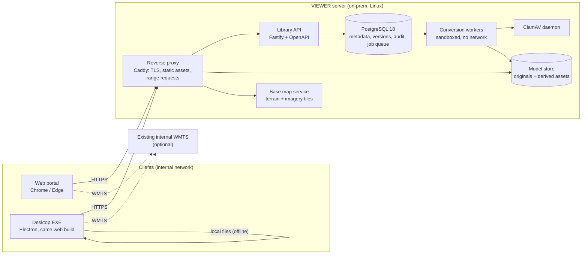
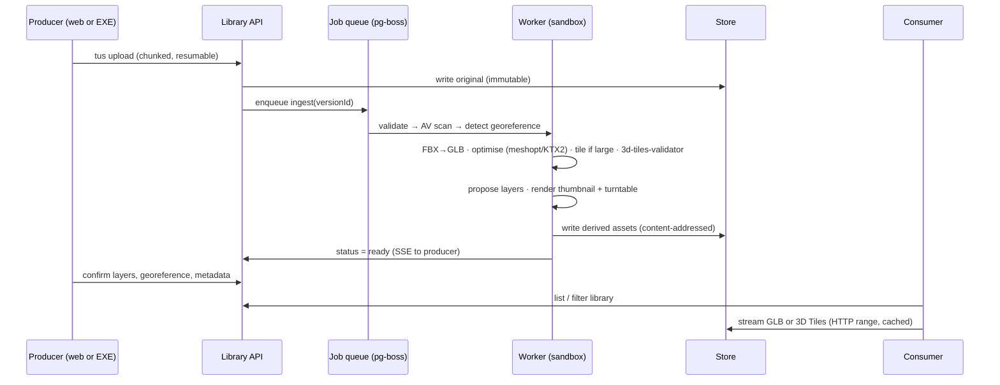
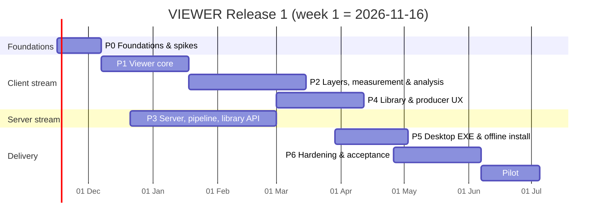

# VIEWER — Implementation Plan

**Product:** 3D Intelligence Model Viewer (VIEWER), Release 1
**Source:** *SRS: 3D Intelligence Model Viewer* (Nov 1, 2026, Lior Ron)
**Status:** Approved by the product owner on 2 Nov 2026. Phase 0 closed on 2 Nov 2026; Phase 1 (viewer core) and Phase 3 (server) in progress.
**Companion docs:** [UI/UX design spec](./UI_UX_DESIGN.md) · [Test data and base map sources](./DATA_SOURCES.md) · [Requirements traceability](./TRACEABILITY.md)

---

## 0. Summary

VIEWER is built as **one TypeScript rendering core on CesiumJS**, shipped two ways: a **web portal** and a **Windows EXE (Electron)** that wraps the exact same web build. All heavy format work (FBX conversion, compression, tiling to 3D Tiles, thumbnails) happens **once on an on-prem server at upload time**, so both clients only ever stream optimised glTF/GLB and OGC 3D Tiles. Everything runs inside the air-gapped internal network: no CDN, no cloud, no telemetry, no licence server.

Release 1 is planned as **7 phases over 29 weeks** (plus a 4-week pilot) with two parallel streams (client and server), a team of about 7, and a formal gate at the end of each phase tied to the SRS acceptance scenarios (AC-01 to AC-10).

| | |
|---|---|
| Threshold requirements covered | 38 / 38 functional + 20 / 20 non-functional ([traceability](./TRACEABILITY.md)) |
| Acceptance scenarios planned | 10 / 10 |
| Formats | FBX, glTF, GLB, **OGC 3D Tiles 1.0 and 1.1** (b3dm, i3dm, pnts, cmpt, glTF/GLB content, implicit tiling) |
| Clients | Web portal (Chrome / Edge) and Windows 10/11 EXE, identical features |
| Calendar | 29 weeks to acceptance, then a 4-week pilot (was 27; +2 weeks for the geospatial scope added on 2 Nov 2026, see 0.2) |

### 0.1 3D Tiles

3D Tiles is treated as a **first-class, day-one format**, not an add-on. It is already in the SRS as a threshold requirement added by the product owner (VWR-FMT-03, VWR-RND-06, AD-04). This plan covers it in four places:

1. **Viewing** 3D Tiles 1.0 and 1.1 tilesets natively in CesiumJS, with screen-space-error level of detail, a VRAM budget, and progressive refinement (Phase 1, WP 1.2 and 1.5).
2. **Uploading** 3D Tiles datasets up to 50 GB as a folder or ZIP, validated with the official `3d-tiles-validator` (Phase 3, WP 3.2 and 3.3).
3. **Producing** 3D Tiles on the server from very large FBX/glTF meshes, so 2 GB models stream inside the 10 GB VRAM cap (Phase 3, WP 3.4).
4. **Opening local tilesets offline** in the EXE through a custom file protocol with HTTP range support (Phase 5, WP 5.3).

### 0.2 Scope added by the product owner on 2 Nov 2026

These requirements are new (not in the SRS). They get their own IDs and are traced like the others.

| ID | Requirement | Where in the plan |
|---|---|---|
| VWR-GEO-01 | Online base map and terrain, so the ground and relief around every model is shown. On the internal network the same layers come from internal servers (same protocols). | WP 1.6, 1.9 |
| VWR-GEO-02 | Load the user's own vector layers: **Shapefile** (.zip or .shp + .dbf + .prj), also GeoJSON and KML. Draped on terrain and models, with attribute pop-ups. | WP 1.9 |
| VWR-GEO-03 | Load the user's own base maps: **GeoTIFF** (including Cloud-Optimised GeoTIFF, any CRS, reprojected on the fly) and **WMTS** services (plus WMS and XYZ). GeoTIFF elevation can be used as terrain. | WP 1.9 |
| VWR-ANL-01 | **Line of sight** between two points, for many pairs at once. Each pair shows visible parts in green and blocked parts in red, with the first obstruction marked. Observer and target heights above ground are editable. | WP 2.8 |
| VWR-ANL-02 | **Height profile** for each pair: terrain and model surface along the line, the sight line, obstructions, distance and heights. | WP 2.8 |
| VWR-ANL-03 | **360° visibility (viewshed)** from an observer point. The observer can be dragged horizontally and raised or lowered, and the visible / hidden map updates live. Radius and observer height are editable. | WP 2.9 |
| VWR-LOD-01 | **Level of detail** made visible and controllable: per-tile LOD colouring, detail slider (screen-space error), freeze LOD, tile statistics. | WP 1.5, 2.10 |
| VWR-DAT-01 | Public georeferenced test data in every supported format, showing the full path from file to globe. | WP 0.8, [DATA_SOURCES](./DATA_SOURCES.md) |

**Prototype status, 2 Nov 2026.** Working in the clickable prototype ahead of their phases, so the product owner can correct them early:
- VWR-GEO-01: base map picker (offline Sentinel-2, bundled world, Esri, EOX, OSM) and terrain picker (offline mirror, AWS Terrain Tiles online). Models and 3D Tiles are seated on the terrain automatically, with a height slider.
- VWR-GEO-02: shapefile (.shp set or .zip, any .prj), GeoJSON and KML, draped on terrain. Click a feature to see its attributes.
- VWR-GEO-03: GeoTIFF / COG (EPSG 4326, 3857, UTM, ITM 2039, Lambert-93 and others) read tile by tile and reprojected; WMTS, WMS and XYZ from a capabilities address; any imagery can be the base map; single-band elevation drawn as shaded relief, and usable as terrain: inside its footprint its heights replace the chosen terrain, outside the chosen terrain stays.
- VWR-ANL-01/02: many line-of-sight pairs with an interactive profile chart, earth curvature and refraction; CSV export of the pairs and of each profile.
- VWR-ANL-03: GPU viewshed (point-light depth cube), drag to move, Shift+drag for height, live update; buildings, lidar and terrain all block the view.
- VWR-LOD-01: LOD inspector for 3D Tiles (colour by depth, detail slider, freeze, bounding boxes, tiles per depth, memory).

**Phase 0 closed, 2 Nov 2026** (product owner: "advance to the next phase"). Carried over:
- WP 0.2 dependency and licence review (including the Autodesk FBX SDK EULA) stays open with security review; it does not block development.
- WP 0.5 tiler bake-off: the custom meshoptimizer tiler (`scripts/build-lod-pyramid.mjs`, used for the Lyon LOD pyramid) is the working choice; mago 3DTiler is compared on a large FBX inside WP 3.4.
- WP 0.6 Windows workstation run: moved to WP 6.7.
- WP 0.8 test data kit: public data in [DATA_SOURCES](./DATA_SOURCES.md) is used until the internal transfer is arranged.

**Phase 1 progress, 2 Nov 2026.** WP 1.1: a test adds a made-up format from one plugin with no change elsewhere. WP 1.4: lighting presets Overcast, Clear noon and Studio neutral beside the sky-and-sun light (sky light as spherical harmonics computed in code, plus sun strength and shadow darkness per preset); each preset also has pre-filtered reflections: the same sky as a 32 px cube map whose mip levels are blurred by the GGX lobe from roughness 0 to 1, written as a KTX2 in memory, so nothing ships as an image file and it works offline. WP 1.5: tile detail (screen-space error) follows the quality preset, and a tiles memory budget (1–8 GB) is in Settings. WP 1.7: the view cube has all 26 views (6 faces, 12 edges, 8 corners); it also turned the wrong way and showed the opposite face, which is fixed and checked for 8 camera directions. WP 1.9: a test reads point shapefiles in UTM 36N, Lambert-93 and the Israeli TM Grid through the same reader the app uses and checks each lands within 1 m (the Israel 1993 datum shift is a few metres, so dropping it fails the test). The 10 reference shapefiles (points, lines and polygons in each of the 3 systems, plus a multipart polygon with a hole and Hebrew names in UTF-8) are now a test, and all land within 1 m. A 2 GB COG streams: `scripts/check-big-cog.cjs` writes a 2.08 GB tiled GeoTIFF with overviews, opens it in the real viewer and looks from 60 km and from 2.5 km; the viewer read 25.6 MB in all (1.2% of the file) and drew the right tiles at both heights. Still to check: 3 public WMTS services, in the final tests on a machine with internet access (this build sandbox has none).

**Phase 1 progress, 3 Nov 2026.** WP 1.6 terrain poke-through: the viewer now lowers the terrain to just under the open model (terrain lowering, not footprint clipping). When the model has loaded, it draws the model once from below with an orthographic camera looking straight up, writing each pixel's distance, so it knows the height of the model's lowest surface at every point of its footprint. That becomes a terrain layer that can only lower the ground, 0.4 m under the model. Each terrain sample takes the lowest value within one sample spacing around it, so the straight terrain triangles between samples cannot rise into a narrow wall. More of the model's tiles arrive as the user looks around, so the capture is taken again once they have loaded, and the terrain is rebuilt only if something new and lower turned up. When the user changes the height offset, the cut follows without a new capture. Heights the viewer reads for placement and measurement still come from the real ground. `scripts/check-terrain-pokethrough.cjs` opens 3 sites in the real viewer on the offline terrain. It paints the globe magenta, then counts magenta pixels inside the model's outline from above, and compares the model's top surface with the terrain on a grid. Before → after, terrain showing through from above: Lyon city mesh 4.91% → 0.70% (6 grid points had the terrain above a roof, worst 19.4 m; now none in any view); a chess set 20 m across on a Jerusalem hillside 22.4% → 0% (144 of 609 points had the terrain above the model, worst 3.0 m; now none); the Tarn lidar point cloud 23.5% → 0.01%. From an angle the pixel count also includes the ground in front of the foot of a wall, so those views are reported but not judged. The grid test cannot sample a point cloud, so Tarn is judged by pixels only, from above only: software rendering of 486 MB of points takes about an hour per view. Costs: each capture is one extra frame (a short hitch), and rebuilding the terrain reloads its tiles.

**Phase 1 progress, 4 Nov 2026.** WP 1.6, the other two acceptance checks: `scripts/check-basemap-switch.cjs` opens a model in the real viewer and, in the same page with no reload, turns the base map off, then the globe off, brings them back, switches to the online presets (Esri World Imagery, AWS Terrain Tiles), then to the site's internal sources (an XYZ imagery server and a Terrarium terrain server set up as the admin would), back to the online ones and back to the offline demo sources. After each switch it checks the ground colour on screen, the terrain height under the model, that the same model is still open, drawn and sitting on the new ground, and that each source was asked for tiles. All pass, 3 runs out of 3; the slowest switch took 3.3 s with software rendering. This sandbox has no internet, so the online presets' real addresses are answered by the test with tiles of a known colour and height; `ONLINE=1` lets them through, for the final tests on a machine with internet. With software rendering, single frames after a terrain swap took up to 10 s and the page sometimes stalled for many minutes, so the check runs with shadows and 4× multisampling off; whether a terrain swap causes a visible hitch on a real GPU is to be checked on the target PCs.

**Phase 1 progress, 4 Nov 2026 (WP 1.2 conformance).** Every sample was opened in the real viewer, with the details in [SAMPLE_CONFORMANCE](./SAMPLE_CONFORMANCE.md) (`scripts/check-sample-conformance.cjs`).

- **3D Tiles:** all 119 open. These are every CesiumGS 3d-tiles-samples tileset, plus CesiumJS's spec tilesets for b3dm, i3dm, pnts, cmpt, implicit tiling and metadata.
- **Khronos glTF:** 311 of the 338 files open. These are all 150 Khronos glTF sample models, in every variant. 136 models open in every variant.
- **Refused:** 14 models require a glTF extension CesiumJS does not implement (KHR_lights_punctual, KHR_materials_transmission, KHR_materials_sheen, KHR_materials_iridescence, KHR_node_visibility), or more morph targets than the GPU draws at once. The viewer refuses these files with a message that names the reason, as the glTF specification says a loader must for a required extension.
- **Found and fixed:**
  - Two CesiumJS bugs that froze all drawing, patched in `patches/`. One hit a b3dm without a batch table under any custom shader, including the ground-cut capture and the unlit view. The other was the sky reflections running one compute command twice when a tileset opened.
  - Tiles that fail to load are now named in a notice, and the model stays open.
  - A model that breaks drawing is now closed with a message while the view keeps drawing. Before, Cesium stopped and showed its own panel.
  - Load-error reasons now name a missing extension and no longer misread ".glb" or ".json" in an address.
- **Language check:** `scripts/check-load-errors.cjs` checks the last two in English and Hebrew.

**Phase 1 progress, 4 Nov 2026 (WP 1.3 georeference).** Test models now land within 10 cm of surveyed positions; the worst point is 0.5 cm.

- **How it was checked:** surveyed points come from PROJ 9.8 (`scripts/proj-reference.py`, the EPSG reference implementation, independent of the proj4js the viewer uses). Sites are 400 m by 300 m with 25 m of relief, in ITM, Israeli Grid 05/12 and UTM 36N, at six places from Eilat to Mount Hermon. `packages/core/src/geo/place.test.ts` checks the maths. `scripts/check-placement.cjs` builds each point into a model, uploads it through the web app's own wizard, opens it and reads back where Cesium draws it: ITM typed in (Y-up GLB), UTM typed in (Z-up GLB), Israeli Grid 05/12 from a ContextCapture `metadata.xml`, and a GLB with its own CESIUM_RTC centre.
- **The chain (plan 4.1):** 3D Tiles root transform → glTF CESIUM_RTC, or an Earth-centred node or vertices (with a warning when 32-bit vertices limit precision, about 26 cm at Earth scale) → a sidecar `metadata.xml` (ContextCapture / iTwin Capture: EPSG code, compound code or ENU frame, plus origin), which fills the Place step → the Place step. The server uses a sidecar position when the request has none. A GLB with its own position is published as it is, with no placement; it is not tiled yet, and the report says so.
- **Found and fixed:**
  - ITM (EPSG:2039) used an outdated datum shift and was off by up to 2.5 m (0.55 m in Jerusalem, 2.5 m in Eilat). It now uses EPSG:1074, as PROJ does, and matches PROJ to 0.1 mm. Israeli Grid 05/12 (EPSG:6991) was added.
  - Every placed model was turned 90°: a glTF's east (+X) pointed north, because Cesium's legacy forward axis was left on. Models now load with forward axis X, so east is +X and north is −Z (Y-up) or +Y (Z-up), as the tools that wrote them meant. The tiler bakes the same orientation, with a test. Models placed before this turn by 90° when reopened.
  - Grid north is not true north away from the central meridian (0.36° on Mount Hermon in ITM, 2° at the edge of a UTM zone), and a grid metre is not a ground metre (projection scale, and the site's height above the ellipsoid). Both are now folded into the placement's heading and scale, and the grid entry is kept beside them. Without this a 400 m site was out by 1.6 m in ITM and 6.9 m in UTM 36N at its corners.
  - The upload wizard kept the last model's up axis, units and heading for the next upload; it now starts from the defaults.
  - Opening a model while the camera was still flying to the last one could throw "This object was destroyed": the terrain-cut capture's orthographic camera made the flight's next step pick against the previous model's freed buffers. The capture now waits for the flight to end; 3 runs of the check were clean after this.
- **Limits:** a placed model is flat on the tangent plane at its origin, which drops away from the ellipsoid by 0.8 cm at 300 m and 8 cm at 1 km, so sites wider than about 2 km belong in 3D Tiles. Heights are ellipsoidal; ITM heights above sea level are about 20 m lower, so leave "Sit the model base on the terrain" on, or enter the ellipsoidal height. EPSG gives the ITM datum shift as accurate to 0.5 m against the Survey of Israel network (0.1 m for Israeli Grid 05/12), so data surveyed in 05/12 should say so.

**Phase 1 progress, 4 Nov 2026 (WP 1.8 app shell).** The shell renders in both languages and both themes, and contrast tests pass.

- **Token contrast:** `packages/ui/src/tokens.test.ts` reads `tokens.css` and checks every text colour against every surface it is drawn on, in both themes, for 4.5:1. Control outlines are checked for 3:1. The glass panels are checked over the canvas colour and over a map as dark as black and as bright as white. It found 13 failures. In dark, faint grey text, the accent, superseded, error and danger colours fell to 3.2–3.7:1 over a bright map. In light, the green and red status colours fell below 4.5:1, and input outlines were 1.5:1, so inputs were hard to see. The panels are now 92% opaque (were 82% and 88%), light green and red are darker, and inputs and secondary buttons have their own outline colour, at 4.2:1 or more.
- **Every screen:** `scripts/check-shell.cjs` opens the real app in English and Hebrew, dark and light. It visits the library, an open model, the command palette, settings, the upload wizard and the help. On each it runs axe-core 4.14 (WCAG 2.1 A and AA), checks `dir` and `lang`, and checks that nothing spills past the window. In Hebrew it lists any English words left in the interface, in visible text, labels and tooltips, but not in what people wrote (model names, metadata and classification names are marked `data-content`). All 88 checks pass.
- **Found and fixed:**
  - Two buttons whose spoken name did not include their visible text (ISO, and the coordinate system).
  - About 50 English strings in the Hebrew shell: the view cube, help, command palette, top bar, dock, layers panel and settings.
  - The language names are marked with their own `lang`.
  - Latin model names now keep their own direction in RTL (`dir="auto"`). Before, "Lyon 1st district" was cut from the wrong end.
  - Memory sizes stay "8 GB" in Hebrew.
- **Limit:** axe cannot judge text over the 3D view (glass with blur over a canvas), which is why the token test checks the worst map backgrounds itself.
- **Left for WP 6.1 (full translation):** the deeper panels still have English written into the code: administration, properties, map and data, the upload wizard's later steps and analysis, roughly 80 strings or more.

**Phase 3 progress, 4 Nov 2026.** WP 3.1 contract and generated client: every API route now declares what it answers, success and error, with shared named shapes (ModelSummary, ModelDetail, Classification, BaseMapConfig, IngestStatus, AuditEvent, Error) in the published OpenAPI. The published copy is `packages/api-client/openapi.json`, and `@viewer/api-client` generates the TypeScript types from it with openapi-typescript 7.13 and wraps them in an openapi-fetch 0.17 client; the web app's library, upload and admin calls go through it, so a path, parameter, body or answer that does not match the API fails the type-check. Contract tests: all server tests run in contract mode, where each JSON answer is checked against the schema for its status and a mismatch, a field the contract does not name, or an unlisted status becomes a 500 naming the route, so the whole suite (62 tests) exercises the contract; further tests check that every operation lists a success and an error answer, that the published copy matches the live server and the generated types match the published copy, and that the app's own types (ModelSummary, ClassificationLevel, BaseMapConfig) are the same as the API's. Found by the switch: the admin page expected the broken audit entry as a number, the server sends a string. openapi-typescript needs the TypeScript 5 compiler API, which TypeScript 7 lacks, so the client package keeps TypeScript 5.9 for itself. After an API change: `UPDATE_API=1 pnpm --filter @viewer/server test`, then `pnpm --filter @viewer/api-client generate`. WP 3.4 kill-worker test (`apps/server/src/worker-kill.e2e.test.ts`, `E2E_KILL=1`): the real server gets a 3 M-triangle mesh, which it tiles, and is killed outright in the middle of tiling. Started again, it takes the job up once the dead worker's lease runs out (`JOB_LEASE_SECONDS`, 15 s in the test, 300 s by default) and publishes 21 s after the kill: exactly one model with one version, every tile present, the original kept, the work files and upload parts gone, and one `model.create` audit entry though the job ran twice. Found while measuring: tiling runs on the server's main thread, and the API took up to 1.4 s to answer while a 3 M-triangle model was tiling; moving the tiler to a worker thread would remove that. WP 3.3 AC-02 bad-file kit (`apps/server/src/ingest.test.ts`, "AC-02"): the eleven corrupt and hostile files from the test data kit go through the real upload and job: a truncated GLB, a GLB with broken JSON, a glTF missing its texture and buffer, a glTF with two problems at once (an extension the viewer cannot read and a missing buffer), an FBX with a damaged header, a file named .fbx that is not FBX, a tileset with two of its three tiles missing, a file of no known kind, a zip bomb, a zip with a path out of the upload, and a damaged zip. Each one fails after one try with a reason that names the file and the problem, the report lists every problem (both missing tiles by name, both problems of the two-problem glTF), no model is made, nothing is published, the work files and upload parts are gone, each refusal is in the audit log once, and the server keeps answering. Found by the test: a damaged zip was reported under the server's internal upload name (a random id ending .part); it now names the file the user sent. AC-08 at API level (`apps/server/src/library-ac08.test.ts`): three people at three workstations. A producer uploads a model with its metadata through the real upload and job; it is found by search in Hebrew and English and by each filter; an editor changes the four fields, the description and the classification, and the change is what everyone sees; the status date moves only when the status changes; the producer uploads a second version with a note, and the first version still opens with its own files. Every step is in the audit log, in order, with the IP and workstation it came from and a time inside the test, and an update records each field's old and new value. Found by the test: an earlier version could not be opened through the API (the history listed it, but nothing returned its files), so `GET /api/models/{id}?version=N` now returns that version and the audit records which version was opened.

**Phase 3 progress, 2 Nov 2026.** WP 3.2 tus uploads with resume, WP 3.3 unpack guards (zip slip, zip bomb, counts and sizes measured while inflating), the shared loader check, a ClamAV hook; WP 3.4 a PostgreSQL job queue with leases (plain SQL, `FOR UPDATE SKIP LOCKED`, instead of pg-boss), FBX→GLB with FBX2glTF, original kept; WP 3.7 file delivery with range, ETag and immutable caching for development (Caddy in production). The web app now finds the server (same origin, or VITE_API_URL), shows its library, and the upload wizard sends files with tus, shows progress and opens the published model; with no server it keeps the sample library and session uploads. Opening a server model is audited. Found in testing: some FBX files come out on their side and at the wrong size (the Stanford bunny is about 800 m across and Z-up), so the Place step now has an up-axis choice (Y or Z up), file units (m, cm, mm, ft, in) and a size readout that warns when a model is larger than 2 km or smaller than 5 cm. WP 3.5: after publishing, headless Chromium opens the web app and renders a 24-frame turntable with the classification band burned into every frame, using the viewer's own engine; changing a model's classification renders it again. With software rendering the thumbnail was ready 43 s after the job started (target 60 s). WP 3.3: the official `gltf-validator` and `3d-tiles-validator` (which also checks every tile's content) run on what will be published, in a child process with a 15-minute limit; the same problem across many files is one line in the report. The viewer's own loader check still decides: validator errors are warnings unless STRICT_VALIDATION is set, since real tilesets often break a rule and still load (Cesium's own discrete-LOD sample has one misaligned tile, Lyon has 72). **Decision, 2 Nov 2026: the product owner chose to allow publishing with validator errors listed as warnings; blocking stays an opt-in (STRICT_VALIDATION=1).** The validator uses sharp, whose libvips is LGPL-3.0 and linked dynamically; this goes on the licence list for review. WP 3.4 tiling: a model over 1.5 M triangles or 300 MB is tiled into 3D Tiles 1.1 by our own tiler (`apps/server/src/tiler.ts`, meshoptimizer 1.3 and glTF-Transform 4.5): median splits until a tile holds at most 100,000 triangles, leaves keep every original triangle, each parent merges its children and simplifies them, and its geometric error is the simplifier's error in metres. Textures are written once and shared by every tile. The up axis and scale from the Place step are baked in, and the upload is kept under `original/`. On the Khronos chess set (1.5 M triangles) it made 341 tiles in 5 levels in 12 s, with no validator errors. Found in testing: the Place step's Z-up option laid a true Z-up model on its side (Cesium's glTF forward axis); fixed, and a Z-up file now faces the same way as the same file in Y-up. AC-07 resume: a 1.5 GB GLB sent with the web app's own upload code to the real server, which is killed outright at 50% and started again 3 s later; the upload carries on from the server's offset (50.0%), finishes and publishes, in 67 s on one machine (`apps/web/src/server/resume.e2e.test.ts`, run with `E2E_RESUME=1`). It found that a fresh DATA_DIR without its parent folders stopped the server from starting; fixed. WP 3.9 admin: one admin password (argon2id, set from ADMIN_PASSWORD on first start) opens the admin page for 8 hours; only a hash of each sign-in token is stored, and an address is locked out after 5 wrong tries. The page manages classification levels (the band text must reach WCAG AA 4.5:1; changing a band re-renders its models' thumbnails), base map and terrain sources for the site with the defaults the viewer opens with and an option to hide the internet sources, a storage quota checked on every new upload, permanent delete with the model's name typed, the audit log with filters, CSV export and a chain check, and the password. The web app now takes its classification levels and base maps from the server. The audit log is admin only. Found in testing: the seeded CONFIDENTIAL band (#C26A00 with white text, 3.9:1) failed the contrast rule and is now #A85C00 (5.0:1); and an audit entry with an empty detail field broke the hash chain, now fixed. **Decision, 2 Nov 2026: the product owner allowed the web app to load maps and data from plain-http internal servers (CSP `http:`).** The desktop app's security policy still lets it reach only local files, so it cannot talk to the server yet; that is WP 5.4. WP 3.8 audit: the database now refuses to change any audit row, or to delete one younger than 366 days (a trigger, so it holds even for direct SQL), and every entry can go to the SIEM as CEF over syslog (UDP, TCP or TLS, `AUDIT_SYSLOG`), in order and only once committed; while the SIEM is down entries wait and go out when it is back. Checked with a test that stops the SIEM mid-stream, and by hand with the server sending to a local listener. WP 3.7 production front end: a Caddy 2.10 config (`deploy/caddy`) serves the web app, API and model files from one HTTPS origin with the organisation's certificate (TLS 1.2+ only, no ACME), streams uploads through unbuffered, serves `/files` with ETag, ranges and year-long immutable caching, and compresses JSON. Found in testing: a re-rendered thumbnail kept its file name, so with immutable caching browsers would have kept showing the old classification band for a year; each render now has a new name and the old file is removed. NFR-05 load test (`scripts/load-20-users.cjs`, 200 MB GLB published through Caddy, then 20 users each opening the library, the model, the whole GLB, 30 range reads and a cached re-check): no errors; in a working session (users start within a minute) the slowest GLB took 0.55 s; with all 20 at the same instant every user had it within 7.6 s (4.4 Gbit/s on a 4-core sandbox shared by server and clients; on a 1 Gbit/s network 4 GB at once takes at least 34 s whatever the server). **Decision, 3 Nov 2026: the product owner chose to read NFR-05 "20 concurrent users" as 20 people working at once (opening models over a minute), not 20 opening the same model in the same second; the load test's pass mark is the working session.**

**Phase 0 progress, 2 Nov 2026.**
- WP 0.1: CI runs type-check, unit tests and build on every push (GitHub Actions; the internal CI repeats the same steps).
- WP 0.4: first FBX bake-off on public files, see [FBX_BAKEOFF](./spikes/FBX_BAKEOFF.md). FBX2glTF is cleanest. **Decision, 2 Nov 2026: the product owner chose FBX2glTF (Autodesk FBX SDK) as the converter on the server and in the desktop app, accepting the Autodesk licence terms; security review still sees the EULA (R-01).** three.js stays as the fallback. Round 2 on 17 public FBX files: FBX2glTF converted 15 with zero validator errors (the other two have no mesh or a damaged header, and fail in every converter).
- WP 1.1 / 1.2 (early): format plugins (`packages/core/src/loaders`) read GLB, glTF with separate files, 3D Tiles 1.0 / 1.1 folders and zips; the upload check lists every problem by name (missing files, damaged tiles, unsupported extensions, size). The upload wizard publishes to the session library and opens the model; FBX is recognised and waits for the server converter.
- WP 1.5 / 4.5 / 4.6 (early): performance overlay (Shift+P: frame rate and time, resolution, tiles, memory) with adaptive resolution down to 60% while frames take over 20 ms; screenshots with the classification banner burned into the image plus a caption (model, version, place, time); share links that restore the model, camera, view mode and hidden layers.
- WP 3.1 / 3.6 / 3.8 (started): `apps/server` with Fastify, PostgreSQL schema and SQL migrations, OpenAPI at `/api/openapi.json`, the library API (search in Hebrew and English, filters, metadata edits, versions) and the hash-chained audit log with CSV export and verification. Tests run on embedded PGlite and, in CI, on PostgreSQL 17. Migrations are plain SQL files rather than Drizzle, one dependency fewer for security review; Drizzle can still be added if the team prefers it.
- WP 0.6: Electron shell with `viewer-file://` range streaming and sandboxing, see [DESKTOP_SHELL](./spikes/DESKTOP_SHELL.md). The Windows workstation run moves to WP 6.7 at the end of the project (product owner, 2 Nov 2026); nothing earlier waits for it.
- WP 0.7: design direction approved (A + C, fading tools).

**Air-gap note.** The SRS network is internal only. Online sources are used for development and demonstrations. Each online layer has an internal equivalent configured by the admin (WP 3.9), so no feature depends on the internet.

---

## 1. Requirements baseline

| Area | Threshold (T) | Objective (O, later) |
|---|---|---|
| FMT — formats | FMT-01, 02, 03, 04, 05, 06, 08 | FMT-07 |
| RND — rendering | RND-01, 02, 03, 04, 05, 06, 08, 09, 10, 11 | RND-07 |
| NAV — navigation | NAV-01, 02, 03, 04, 05, 07 | NAV-06, 08 |
| LYR — layers | LYR-01, 02, 03, 04, 05 | LYR-06, 07 |
| MSR — measurement | MSR-01, 02, 03, 04, 05, 06, 08 | MSR-07 |
| UPL — upload & library | UPL-01 to UPL-10 | — |
| ADM — access & admin | ADM-01, 02, 03 | — |
| NFR | NFR-01 to NFR-20 | — |

Objective requirements are **not built in Release 1**, but the architecture leaves a named seam for each one (section 4.4), so none of them needs a redesign later.

### 1.1 Product-owner decisions

These came from checking the SRS against what the chosen tools can actually do. All five were accepted by the product owner on 2 Nov 2026.

| # | Topic | Finding | Proposed resolution |
|---|---|---|---|
| D-1 | WebGPU | SRS 2.3 says "WebGPU used when available". CesiumJS 1.146 (Oct 2026) is WebGL 2 only and has no WebGPU backend. | **Accepted by product owner, 2 Nov 2026:** WebGL 2 is the Release 1 renderer (the stated baseline; meets every NFR). Revisit if CesiumJS ships WebGPU. |
| D-2 | NFR-08 Khronos visual check | CesiumJS supports core metallic-roughness plus `KHR_materials_unlit`, `_specular`, `_anisotropy`, `_clearcoat`, `KHR_texture_transform`, `KHR_texture_basisu`, but not `_transmission`, `_volume`, `_sheen`, `_iridescence`. | **Accepted by product owner, 2 Nov 2026:** run AC-03 on core-PBR Khronos samples that use no extensions and have open licences: SciFiHelmet, WaterBottle, BoomBox, Lantern, Corset (CC0) and MetalRoughSpheres (CC BY 4.0). FlightHelmet and ABeautifulGame were dropped because they use `KHR_materials_transmission`; DamagedHelmet (CC BY-NC) and Sponza (Cryengine licence) because of their licences. These extensions are not used by terrain/urban models. |
| D-3 | FBX read directly in the EXE (SRS 5.3) | Reading FBX in the client conflicts with AD-03. | **Accepted by product owner, 2 Nov 2026:** The EXE bundles the **same converter binary** as the server and converts locally to GLB in a sandboxed child process. Same result, one code path. |
| D-4 | Tauri vs Electron (AD-02 leaves it open) | See 3.2. | **Accepted by product owner, 2 Nov 2026:** Electron, for one pinned Chromium in both clients (NFR-18 parity, accreditation of one browser engine). |
| D-5 | Identity without login (ADM-01, NFR-11) | "Workstation name" over HTTP is not sent by browsers. | **Accepted by product owner, 2 Nov 2026:** Log IP plus reverse-DNS hostname on the server; the EXE also sends the Windows computer name in a header. Web clients log IP + reverse DNS only. |

---

## 2. Architecture

### 2.1 System context



### 2.2 Upload-to-view data flow



### 2.3 Client architecture (shared by web and EXE)

```
apps/web  ───────────────┐            apps/desktop (Electron)
  React shell, routes     │              main process: files, local converter,
                          │              custom protocol viewer-file://
                          ▼                       │ loads the same build
packages/ui        design system (tokens, components, icons, motion)
packages/app       screens: Library, Viewer, Upload, Admin; state (Zustand)
packages/core      ◀── the only package that imports CesiumJS
  engine/           Viewer lifecycle, render settings, VRAM budget, quality presets
  plugins/          LoaderPlugin · LayerProvider · ToolPlugin interfaces (NFR-19)
  loaders/          gltf, glb, 3dtiles, (fbx → via converter)
  geo/              georeference, CRS (proj4 + bundled EPSG defs), ECEF, UTM
  measure/          picking, snapping, geodesic math (double precision)
  layers/           layer tree, visibility, isolate, manifest application
  basemap/          terrain + imagery providers, footprint clipping
  camera/           navigation controller, view cube, fly-to
packages/api-client typed client generated from the OpenAPI spec
packages/shared     DTOs, zod schemas, error codes, i18n keys
```

**Rules that keep the core clean**

- `packages/core` exposes a small, framework-free API (`viewer.open()`, `viewer.layers`, `viewer.tools.measure`, events). React never touches Cesium objects. This is what lets thumbnails, tests and both clients use the same core.
- Per-frame data (cursor coordinates, FPS, live measurement) flows through a tiny signal store read with `useSyncExternalStore`, not React state, so the UI never re-renders 60 times per second.
- Every format is a `LoaderPlugin { canLoad(source); load(source, ctx): LoadedModel }`. Adding OBJ or I3S later (FMT-07) touches only a new plugin (NFR-19).
- Every tool (measure distance, measure path, later area/section/walk) is a `ToolPlugin` with `activate / deactivate / onPointer / hint`. Only one tool is active at a time (SRS 5.1 "one active tool").

### 2.4 Server architecture

| Component | Tech | Notes |
|---|---|---|
| Reverse proxy | Caddy 2 (Apache-2.0) | TLS with the organisation's certificates (NFR-13), static serving of derived assets with `Range`, `ETag`, `Cache-Control: immutable` on content-addressed paths. |
| Library API | Node.js 26 LTS, Fastify 5, TypeScript | OpenAPI 3.1 generated from zod schemas; the typed client is generated from it. |
| Upload | `@tus/server` 2 (MIT) + `tus-js-client` 4 | Chunked, resumable uploads for 2 GB files and 50 GB tilesets (UPL-03, AC-07). ZIPs and folders (folder upload uses `webkitdirectory` + per-file tus with a manifest). |
| Database | PostgreSQL 18 | Metadata, versions, layer manifests, audit log, and the job queue (pg-boss), so there is no Redis to accredit. Full-text + `pg_trgm` for library search in Hebrew and English. |
| ORM / migrations | Drizzle ORM | SQL-first, typed. |
| Job queue | pg-boss 12 (MIT) | Retries with backoff, dead-letter, exactly-once per version (NFR-10). |
| Workers | Node.js + native tools in rootless Podman containers | `--network=none`, read-only root, seccomp default, CPU/RAM/time limits, run as non-root (NFR-14). |
| Antivirus | ClamAV (clamd), offline signature updates via the organisation's update process | Every uploaded file, including every file inside a ZIP. |
| Model store | Plain filesystem volume (local disk, NAS via NFS/SMB) with content-addressed layout | Meets 10 TB / 5,000 versions (NFR-06) without an object store to accredit. An S3-compatible store can be swapped in behind the same interface. |
| Base map service | Static tile trees served by Caddy (quantized-mesh terrain + imagery XYZ/TMS), or MBTiles/PMTiles served by Martin (Apache-2.0/MIT) | Installed from the separate base map package (RND-11). |
| Audit log | Append-only table with a hash chain (each row stores the hash of the previous row) + syslog/CEF forwarder for a SIEM | Kept ≥ 1 year (NFR-11). |
| Deployment | One offline bundle: container images as tarballs, `install.sh`, systemd units, admin guide | Clean install in ≤ 2 h (NFR-20). |

**Storage layout**

```
/store/originals/<sha256>/<original filename>        immutable, never deleted except by admin
/store/derived/<versionId>/model.glb                   optimised GLB (small/medium models)
/store/derived/<versionId>/tiles/tileset.json          3D Tiles (uploaded or generated)
/store/derived/<versionId>/thumb.webp, turntable.webp  thumbnail + 24-frame turntable sprite
/store/derived/<versionId>/layers.json                 proposed + confirmed layer manifest
```

### 2.5 Conversion pipeline (per uploaded version)

| Step | Tool | Output / rule |
|---|---|---|
| 1. Unpack and inventory | Node `yauzl` (MIT) | Reject zip-bombs (ratio and size caps), path traversal, symlinks. |
| 2. Antivirus | ClamAV | Infected → rejected, logged, original quarantined. |
| 3. Validate | glTF: `gltf-validator` (Apache-2.0). 3D Tiles: `3d-tiles-validator` 0.6 (Apache-2.0). FBX: converter dry-run | Every problem reported, with file name and reason (UPL-02, FMT-05). |
| 4. Georeference | Read 3D Tiles root transform, glTF `CESIUM_RTC` / node transform, or sidecar `.prj` / world file; else hold for producer input | No georeference → status *Needs georeference* (FMT-08). |
| 5. FBX → glTF | Converter chosen in Phase 0 spike (3.4) | Material mapping table Phong / Lambert / Stingray PBS → metallic-roughness (RND-02). |
| 6. Optimise | glTF-Transform 4.5 (MIT): dedup, weld, `meshopt` compression, KTX2 (UASTC for normals, ETC1S for colour) via KTX-Software `toktx` (Apache-2.0) | Draco also accepted on input (FMT-04). |
| 7. Tile if large | If > 1.5 M triangles or > 300 MB after optimisation → 3D Tiles 1.1 (tiler chosen in Phase 0, see 3.4) | Large models stream within the VRAM cap (AD-04). |
| 8. Propose layers | Walk node hierarchy / tilesets / `EXT_structural_metadata` classes; suggest names from the standard list by keyword heuristics | `layers.json` (UPL-09). |
| 9. Thumbnail | Headless Chromium (Playwright) renders the model with `packages/core` itself | Thumbnail looks exactly like the viewer (UPL-08), with the classification banner burned in (UPL-10). |
| 10. Publish | Mark version *ready*, push event over SSE | Failed steps retry 3× then report; original is always kept (NFR-10). |

---

## 3. Technology choices and the alternatives considered

Each choice is scored against the constraints that matter most here: **air-gapped deployment and licence review (C-1, C-2)**, **georeferencing and 3D Tiles (Q-03, FMT-03)**, **web/EXE parity (NFR-18)**, **rendering quality (RND, NFR-08)**, and **team productivity**.

### 3.1 Rendering engine (AD-05)

| Option | Licence | Georef / globe / terrain | 3D Tiles 1.1 | PBR quality | Measurement & geodesy | Verdict |
|---|---|---|---|---|---|---|
| **CesiumJS 1.146** | Apache-2.0 | Native WGS84 globe, quantized-mesh terrain, WMTS/TMS imagery, clipping polygons on terrain | Native, reference implementation | Metallic-roughness, IBL, PBR Neutral tone mapping, soft shadows, AO | ECEF, ellipsoid geodesics, `pickPosition`, experimental `Scene.snap` | **Chosen** (as in SRS AD-05) |
| three.js + 3DTilesRendererJS | MIT / Apache-2.0 | No globe; terrain, imagery draping, ellipsoid all custom | Good | Best-in-class PBR, WebGPU renderer | All custom | Strong runner-up; too much geo work to rebuild |
| Babylon.js | Apache-2.0 | No globe; community 3D Tiles only | Partial | Excellent PBR, WebGPU | Custom | Not chosen |
| iTwin.js (Bentley) | MIT | Good, but tied to iModel format and services | Via reality data | Good | Good | Heavy, cloud-oriented |
| Unity / Unreal + Cesium plug-in | Commercial EULA | Good | Good | Excellent | Good | Licence review, no real web parity (AD-02) |
| Native C++ (VSG / osgEarth) | MIT / LGPL | Good | Partial | Medium | Good | Two codebases for web and EXE (AD-01) |

**CesiumJS features this plan relies on, checked against the 1.146 changelog:** clipping polygons on terrain and tilesets (RND-10), `Tonemapper.PBR_NEUTRAL` (RND-04, NFR-08), `ImageBasedLighting` with custom specular environment maps on WebGL 2 (RND-03), `debugWireframe` and `EdgeDisplayMode` for `EXT_mesh_primitive_edge_visibility` (RND-05), `KHR_meshopt_compression` / `EXT_meshopt_compression`, Draco and `KHR_texture_basisu` (FMT-04), I3S support (FMT-07 later), Gaussian splats (future reality capture).

**Gaps we fill ourselves:** "shaded with edges" for models that do not carry edge data (a depth/normal edge-detection post-process stage); vertex/edge snapping where `Scene.snap` does not apply (our own BVH snapping, see WP 2.3); cursor-anchored zoom and double-click pivot (custom camera controller, WP 1.7).

### 3.2 Desktop shell (AD-02)

| Option | Engine | Offline install, no admin | Parity with web | Size | Verdict |
|---|---|---|---|---|---|
| **Electron 45** | Bundled Chromium, pinned | Yes (NSIS per-user) | Exact: one Chromium version for both QA and accreditation | ~110 MB | **Chosen** |
| Tauri 2 | System WebView2 (Evergreen) or fixed-version WebView2 | Yes | Close; WebView2 version varies per machine unless fixed-version runtime is bundled | ~10 MB (+~150 MB with fixed runtime) | Good fallback if size matters |
| PWA (install from portal) | User's browser | Yes | Same as web | 0 | Cannot open local files offline robustly or run the local FBX converter (ADM-03) |
| Native WebView2 wrapper (.NET) | WebView2 | Yes | Close | Small | More custom code than Electron |

Electron hardening: `contextIsolation: true`, `sandbox: true`, `nodeIntegration: false`, strict CSP, a narrow typed preload API (`openFile`, `convertFbx`, `serverStatus`), no remote content except the configured server, auto-update off (updates are delivered as new signed installers through the organisation's process).

### 3.3 Front-end stack

| Concern | Choice (version) | Alternatives considered | Why |
|---|---|---|---|
| Language | TypeScript 7.0 | — | Native compiler, fast CI. |
| Build | Vite 8 | Webpack, Rspack | Fast, simple Cesium asset handling. |
| UI framework | React 19.3 | Svelte 5, SolidJS, Vue 3 | Largest hiring pool and component ecosystem; per-frame data kept outside React (2.3). |
| Headless components | Radix UI primitives | React Aria, Ark UI | Accessible, unstyled, built-in `DirectionProvider` for RTL. React Aria is an equal alternative. |
| Styling | Tailwind CSS 4.3 + CSS variables (design tokens) | vanilla-extract, CSS Modules | Logical properties (`ms-`, `pe-`) give RTL for free. |
| State | Zustand 5 (+ signals for per-frame values) | Redux Toolkit, Jotai | Small, explicit. |
| Data fetching | TanStack Query 5 | SWR | Cache, retries, optimistic metadata edits. |
| Routing | TanStack Router 1 | React Router | Typed search params for shareable views. |
| Command palette | cmdk 1.1 | kbar | Ctrl+K for every action. |
| Motion | Motion 14 | react-spring | Spring physics, reduced-motion support. |
| i18n | i18next 26 + react-i18next 17 | FormatJS | Runtime language switch without restart (NFR-16), ICU plurals, Hebrew. |
| Icons | Lucide (ISC) + custom 3D tool icons | Phosphor, Tabler | Clean geometric line icons, easy to extend. |
| Fonts | IBM Plex Sans, IBM Plex Sans Hebrew, IBM Plex Mono (OFL-1.1), bundled | Inter + Heebo | One family designed for Latin and Hebrew together; mono for coordinates. |
| Geodesy | geographiclib-geodesic 2.2 (MIT), proj4 2.22 (MIT) + bundled EPSG definitions | Turf | Ellipsoidal accuracy for NFR-07; UTM for MSR-08. |
| Tests | Vitest 5, Playwright 1.64 (incl. screenshot comparison) | Jest, Cypress | Same Chromium as Electron for visual tests. |

### 3.4 Format conversion tools (biggest technical risk: R-01, R-02)

**FBX → glTF.** Decided in the Phase 0 bake-off on 10 real producer files.

| Option | Licence | Notes |
|---|---|---|
| **ufbx + our own glTF writer (C, compiled native and WASM)** | MIT / public domain | Modern, robust single-file FBX loader, ASCII and binary, FBX 2014+. No Autodesk SDK. Same code on server and in the EXE. **Leading candidate.** |
| Assimp | BSD-3 | Broad format support (also OBJ for FMT-07); FBX materials less faithful. Fallback. |
| Blender headless (`blender -b --python`) | GPL (run as a separate tool, not linked) | Very good material handling; heavy (~400 MB), slower. Fallback for difficult files. |
| FBX2glTF | BSD, but **statically links the Autodesk FBX SDK** | Carries the same licence question as the SDK (C-3). Only if Autodesk licence is cleared. |
| Autodesk FBX SDK direct | Autodesk licence | Best fidelity; needs licence clearance (R-01). |

**Large mesh → 3D Tiles.**

| Option | Licence | Notes |
|---|---|---|
| **mago 3DTiler (Gaia3D)** | MPL-2.0 (commercial licence also offered) | Java; inputs FBX, OBJ, glTF/GLB, 3DS, DAE, CityGML, IFC, LAS/LAZ, SHP, GeoJSON; outputs 3D Tiles 1.1 (or 1.0). **Leading candidate.** |
| Custom tiler on meshoptimizer 1.3 (MIT) clustering + `3d-tiles-tools` 0.5 (Apache-2.0) | MIT / Apache-2.0 | Full control over quality; ~4 extra engineer-weeks. Fallback. |
| py3dtiles | Apache-2.0 | Strong for point clouds (`pnts`), weak for textured meshes. Use for LAS if needed. |
| Obj2Tiles | AGPL-3.0 | Excluded: AGPL is unlikely to pass licence review (C-2). |
| Cesium ion Self-Hosted | Commercial | Best tiler quality; budget and licence process. Option if the bake-off fails. |

### 3.5 Base maps (RND-08 to RND-11)

| Concern | Choice | Alternatives |
|---|---|---|
| Terrain format | Cesium quantized-mesh 1.0 (+ normals extension) | Heightmap tiles (lower quality) |
| Terrain build | `cesium-terrain-builder` (Apache-2.0) via GDAL from the organisation's DEM (GeoTIFF, DTED) | Cesium ion Self-Hosted (commercial) |
| Imagery build | GDAL (MIT) `gdal2tiles` / `gdal_translate -of MBTILES` from orthophotos | MapProxy (Apache-2.0) |
| Imagery serving | Static XYZ under Caddy, or MBTiles/PMTiles via Martin | GeoServer (GPL), MapServer (MIT) |
| Existing WMTS | `WebMapTileServiceImageryProvider` by URL + layer name from admin settings | — |
| Model over terrain | `Globe.clippingPolygons` with the model's footprint polygon (computed at upload), plus a small depth offset | Lower terrain under the footprint |

### 3.6 Server-side alternatives considered

| Concern | Chosen | Alternatives | Why |
|---|---|---|---|
| API runtime | Node.js 26 LTS + Fastify | Python FastAPI, Go, .NET 10 | Shares TypeScript types and zod schemas with the client; glTF-Transform and Playwright are Node-native. |
| Queue | pg-boss on PostgreSQL | BullMQ + Redis, RabbitMQ | One fewer component to accredit and back up. |
| Object storage | Filesystem | MinIO (AGPL-3.0, licence risk), SeaweedFS (Apache-2.0), Ceph | Simplest to accredit, back up and restore. |
| Search | PostgreSQL FTS + `pg_trgm` | Meilisearch, OpenSearch | ≤ 5,000 versions do not need a search engine. |
| Containers | Podman (rootless) | Docker Engine | Rootless by default; better fit for workers handling untrusted files. |

### 3.7 Pinned versions (checked on npm, 1 Nov 2026)

`cesium 1.146.0` · `electron 45.2.1` · `electron-builder 26.18.0` · `react 19.3.1` · `vite 8.3.5` · `typescript 7.0.2` · `tailwindcss 4.3.3` · `zustand 5.0.16` · `@tanstack/react-query 5.105.1` · `@tanstack/react-router 1.170.46` · `i18next 26.7.1` · `react-i18next 17.1.11` · `motion 14.9.0` · `cmdk 1.1.1` · `fastify 5.12.7` · `@tus/server 2.4.6` · `tus-js-client 4.3.1` · `pg-boss 12.38.0` · `drizzle-orm 0.45.4` · `zod 4.6.7` · `@gltf-transform/core 4.5.1` · `3d-tiles-tools 0.5.4` · `3d-tiles-validator 0.6.1` · `meshoptimizer 1.3.0` · `proj4 2.22.0` · `geographiclib-geodesic 2.2.0` · `vitest 5.0.5` · `@playwright/test 1.64.1` · `pnpm 12.16.1` · `turbo 2.11.10` · Node.js 26.13 LTS · PostgreSQL 18.

All versions are pinned exactly in `pnpm-lock.yaml` and mirrored into an internal npm registry (Verdaccio, MIT) for offline builds. Upgrades happen deliberately, once per release, after the security review.

---

## 4. Cross-cutting design

### 4.1 Georeferencing and precision

- Every model is placed by a 4×4 ECEF transform. Sources, in priority order: 3D Tiles root `transform` → glTF `CESIUM_RTC` / root node transform → `.prj` + world file / sidecar JSON → origin + CRS entered at upload (EPSG code from a bundled list, Israeli Grid ITM EPSG:2039 and UTM 36N EPSG:32636 at the top).
- All coordinates are kept in `Float64Array` / `Cartesian3` (doubles) on the CPU; rendering uses Cesium's relative-to-eye path, so a 50 km city has no jitter.
- Measurements (section 6.4 of the SRS): picked point → ECEF (double) → 3D distance in ECEF; horizontal distance as the geodesic on WGS84 (GeographicLib, Karney's method, nanometre accuracy); height difference along the local vertical (ellipsoid normal at the first point). Total path length is the sum of 3D segments.
- MSR-06: if the model has no reliable scale (unit flag missing, or the producer marks it), measurements are labelled "model units" and a warning chip is shown.

### 4.2 Performance budget (reference: RTX A4000, 16 GB)

| Budget | Target | Mechanism |
|---|---|---|
| First frame, 200 MB GLB | ≤ 5 s (NFR-01) | Meshopt + KTX2 (≈ 4–6× less to download and upload to GPU), streaming parse in a worker, textures upload after geometry. |
| First coarse view, 3D Tiles | ≤ 3 s (NFR-02) | Root tile preloaded; `maximumScreenSpaceError` 16 while moving, 8 when still; skip-LOD. |
| Frame rate | ≥ 60 fps average, never < 30 (NFR-03) | Adaptive resolution scale (0.6–1.0) when frame time > 16.6 ms; shadows and AO turn off during camera motion and fade back in on stop. |
| VRAM | ≤ 10 GB default, configurable (NFR-04) | `cacheBytes` + `maximumCacheOverflowBytes` per tileset; one global budget manager across tilesets, GLBs, terrain and imagery; quality presets (Low / Balanced / High / Ultra). |
| Concurrent users | 20 with no slowdown (NFR-05) | Static, cacheable assets; API is metadata only. k6 load test in Phase 6. |

### 4.3 Security

- No outbound calls: Cesium's ion defaults are removed (`Ion.defaultAccessToken` unset, no `createWorldTerrain`, no Bing), all fonts/icons/HDRs bundled, CSP `connect-src` limited to the configured server and WMTS. Verified by AC-10 (packet capture) and an automated test that runs the full E2E suite in a container with `--network=none` + local server only.
- Uploads parsed only inside sandboxed workers (NFR-14). Clients never parse FBX.
- Admin: password hashed with argon2id, set at install, rate-limited, session cookie `HttpOnly; Secure; SameSite=Strict`.
- Audit (NFR-11): `upload`, `view`, `metadata.update`, `status.change`, `classification.change`, `version.create`, `delete`, `admin.login` with IP, hostname, EXE computer name (if present) and time. Hash-chained, exportable.
- Supply chain: SBOM (CycloneDX) per release, licence report, `pnpm audit` against an offline advisory mirror, reproducible builds, signed installers.

### 4.4 Seams for objective (later) requirements

| Objective | Seam ready in R1 |
|---|---|
| FMT-07 OBJ, photogrammetry 3D Tiles, I3S | `LoaderPlugin`; CesiumJS already reads I3S; Assimp/mago already read OBJ. |
| RND-07 sun by date/time | Sun light already driven by `JulianDate`; only UI needed. |
| NAV-06 walk mode | `CameraController` modes; W key reserved. |
| NAV-08 bookmarks | Share-view state object (camera + layers) is already serialisable. |
| LYR-06 transparency | Layer model carries an `opacity` field (unused in R1). |
| LYR-07 section plane/box | `ClippingPlaneCollection` wiring in core; "Section" slot in dock shown disabled. |
| MSR-07 area, height above ground | `ToolPlugin`; measurement store supports polygon type. |

---

## 5. Delivery plan

### 5.1 Team (assumed; adjust to actual staffing)

| Role | FTE | Owns |
|---|---|---|
| Tech lead / 3D graphics engineer | 1 | `packages/core`, rendering, performance, architecture decisions |
| Front-end engineers | 2 | `packages/ui`, `packages/app`, Electron shell, i18n/RTL |
| Back-end engineer | 1 | API, uploads, database, audit, admin, deployment |
| 3D pipeline engineer | 1 | Converters, tiling, base map build, test data |
| Product designer (UI/UX) | 1 (0.5 after Phase 4) | Design language, prototypes, usability tests |
| QA / test automation | 0.5 → 1 in Phase 6 | Acceptance suites, visual regression, perf runs |
| DevOps / security liaison | 0.5 | CI, offline mirror, installers, accreditation package |

### 5.2 Timeline



| Phase | Weeks | Gate |
|---|---|---|
| P0 Foundations & de-risking | 1–3 | G0: engine, FBX converter, tiler and shell decisions signed; design direction approved |
| P1 Viewer core | 4–9 | G1: AC-03, AC-04 pass on glTF/GLB and 3D Tiles (web) |
| P2 Layers, measurement & analysis | 10–17 | G2: AC-05, AC-06 pass (web); line of sight, profile and viewshed checked against reference DEM results |
| P3 Server, pipeline, API | 6–15 | G3: AC-02, AC-07, AC-09 pass at API level |
| P4 Library & producer UX | 16–21 | G4: AC-01 (web), AC-07, AC-08 end to end |
| P5 Desktop EXE & offline | 20–24 | G5: AC-01 in EXE incl. offline; AC-10 dry run |
| P6 Hardening & acceptance | 24–29 | G6: all AC-01 to AC-10 pass in both clients; NFRs measured |
| Pilot | 30–33 | Go-live decision |

Calendar assumes no holiday gaps; add the organisation's holidays when the start date is fixed.

### 5.3 Work packages

Each work package (WP) lists its tasks, what it depends on, and how we know it is done.

#### Phase 0 — Foundations & de-risking (weeks 1–3)

| WP | Tasks | Depends on | Done when |
|---|---|---|---|
| 0.1 Repo & CI | pnpm + Turborepo monorepo; ESLint, Prettier, TS strict; Vitest, Playwright; CI (lint, type-check, unit, E2E, visual) on the internal CI; Verdaccio offline mirror; CycloneDX SBOM job | — | Green pipeline on an empty app; build works with network off |
| 0.2 Dependency submission | Licence list of every runtime and build dependency, sent to security review | 0.1 | List submitted (R-05); feedback loop scheduled |
| 0.3 Engine spike | Load 10 Khronos samples + 2 urban tilesets in CesiumJS; side-by-side vs Khronos Sample Viewer; IBL with bundled HDR; PBR Neutral; edges post-process prototype | — | Diff report; D-1, D-2 confirmed |
| 0.4 FBX bake-off | ufbx, Assimp, Blender, (FBX2glTF if licence allows) on 10 real producer FBX files: materials, textures, hierarchy, time, crashes | Producer sample files | Converter chosen, material mapping table v1 (R-01, R-02) |
| 0.5 Tiler bake-off | mago 3DTiler vs custom meshoptimizer tiler on a 2 GB FBX and the Helsinki mesh | Test data | Tiler chosen; quality/time numbers recorded |
| 0.6 Shell spike | Electron per-user install with network off; `viewer-file://` protocol serving a 50 GB local tileset with range requests | — | D-4 confirmed; EXE opens local tileset at ≥ 60 fps |
| 0.7 Design direction | Design tokens, type, icon set, key screens in high fidelity (Library, Viewer, Measure, Upload), clickable prototype; 5 hallway tests | — | Product owner approves the direction ([UI/UX spec](./UI_UX_DESIGN.md)) |
| 0.8 Test data kit | Assemble the kit in [DATA_SOURCES](./DATA_SOURCES.md); surveyed reference distances for AC-06; corrupt files for AC-02 | — | Kit transferred to the internal network via the approved process |

#### Phase 1 — Viewer core (weeks 4–9)

| WP | Tasks | Requirements | Done when |
|---|---|---|---|
| 1.1 Core skeleton | `ViewerEngine` facade, plugin registry (`LoaderPlugin`, `LayerProvider`, `ToolPlugin`), event bus, signal store, error taxonomy | NFR-19 | A new dummy format plugin loads with zero changes outside its folder |
| 1.2 Loaders | glTF (+ external .bin/images), GLB, 3D Tiles 1.0/1.1 (b3dm, i3dm, pnts, cmpt, glTF content, implicit tiling, `EXT_structural_metadata`); Draco, meshopt, KTX2; friendly errors | FMT-02, 03, 04, 05 | All Khronos + 3D Tiles samples open; corrupt files show a named reason without crash |
| 1.3 Georeference | Transform resolution chain (4.1); CRS list with proj4; placement on globe | FMT-08 | Test models land within 10 cm of surveyed positions |
| 1.4 Rendering | PBR + IBL (3 bundled HDRs pre-filtered to KTX2 cubemaps: Overcast, Clear noon, Studio neutral); sun with soft shadows (toggle); PBR Neutral tonemap; MSAA 4× + FXAA; SSAO; view modes: Shaded, Shaded + edges, Wireframe, Unlit | RND-01, 03, 04, 05 | AC-03 visual sign-off by 2 reviewers |
| 1.5 3D Tiles performance | SSE policy, skip-LOD, global VRAM budget manager, adaptive resolution, quality presets, perf HUD (Shift+P); LOD inspector hooks (tile depth, SSE, loaded/visible counts) | RND-06, NFR-02, 03, 04, LOD-01 | 3D Tiles first view ≤ 3 s; ≥ 60 fps average on A4000; no crash at budget |
| 1.6 Base maps & terrain | Terrain (quantized-mesh, or heightmap tiles such as Terrarium) + imagery (XYZ/TMS/WMTS/MBTiles via Martin) providers from admin config; **online presets for demos** (AWS Terrain Tiles, Esri World Imagery, OpenStreetMap, Sentinel-2 cloudless) and internal equivalents; model sits on terrain (footprint clipping or terrain lowering); source picker; works with no base map | RND-08, 09, 10, 11, GEO-01 | No terrain poke-through on 3 test sites; viewer works with base map off; online and internal sources switch without restart |
| 1.7 Navigation | Cursor-anchored zoom (wheel, pinch, +/−), orbit around double-click pivot (left-drag), pan (right/middle-drag, arrows), view cube with 26 hot-spots, compass + north arrow, Home, Focus selection, eased fly-to; `?` help overlay | NAV-01–05, 07 | AC-04 passes with mouse, keyboard and touchpad |
| 1.8 App shell | Design system components; top bar, dock, collapsible side panels; command palette; dark/light themes; i18next with Hebrew/English and RTL from day one | NFR-16, 17 (foundations) | Shell renders in both languages and themes; contrast tests pass |
| 1.9 User data layers | Data panel: add **Shapefile** (shpjs in a worker, .prj via proj4), GeoJSON, KML; **GeoTIFF / COG** imagery and elevation (geotiff.js, reprojection to Web Mercator or geographic tiles in a worker); **WMTS** from a GetCapabilities URL with layer / style / matrix-set picker, plus WMS and XYZ; order, opacity, show/hide, zoom-to; layers saved with the view | GEO-02, 03 | 10 reference shapefiles (points, lines, polygons, 3 CRSs) land within 1 m; a 2 GB COG streams without loading fully; 3 public WMTS services load from capabilities |

#### Phase 2 — Layers, measurement & analysis (weeks 10–17)

| WP | Tasks | Requirements | Done when |
|---|---|---|---|
| 2.1 Layer model | Derive tree from glTF nodes, 3D Tiles tilesets and metadata classes; apply saved manifest (rename/merge/nest/order); visibility via node `show` and tileset style | LYR-01, 02, 03 | Visibility matches panel in every case of AC-05 |
| 2.2 Layers panel | Tree with eye toggles, parent cascades, Show all / Hide all, search with highlight, Isolate + undo isolate, hover-to-highlight in 3D, Alt+click solo, drag-paint visibility | LYR-01–05 | AC-05 passes |
| 2.3 Picking & snapping | Depth-accurate `pickPosition`; snap to vertices/edges within 10 px using `Scene.snap` where edge data exists, otherwise a per-tile BVH built in a worker (three-mesh-bvh style, MIT); snap glyphs | MSR-03 | Snap hit-rate ≥ 99% on test set within 10 px |
| 2.4 Measurement engine | 2-point and path tools; ECEF/geodesic maths (4.1); units m/ft; "model units" mode | MSR-01, 02, 06, NFR-07 | Error ≤ 0.1% or 1 cm on surveyed distances |
| 2.5 Measurement UI | Live in-canvas label with 3D / horizontal / vertical triangle; sidebar cards with rename, hide, delete, copy; units toggle | MSR-04, 05 | AC-06 passes |
| 2.6 Coordinates | Cursor + point coordinates in WGS84 or UTM (zone auto-detected or chosen), remembered per workstation, copy | MSR-08 | Values match proj reference to 1 mm |
| 2.7 Accuracy harness | Automated test comparing measurements to survey data in both clients | NFR-07, 18 | Web vs EXE identical to 1 mm |
| 2.8 Line of sight & profile | Pair tool: click observer then target, repeat for many pairs; per-pair heights above ground; sight line coloured visible / blocked with first obstruction; profile chart (terrain + model surface sampled with `sampleHeightMostDetailed`, earth curvature and refraction k = 0.13 optional); pair list with rename, hide, delete, export CSV | ANL-01, 02 | Results match a GDAL reference on the test DEM to 1 sample; 20 pairs stay interactive |
| 2.9 Viewshed 360° | GPU viewshed: depth cube rendered from the observer (6 faces, or a point-light shadow map), compared per pixel in a post-process stage, so terrain and 3D models both block; visible / hidden overlay with radius ring; drag handle moves the observer on the ground, a vertical handle and slider change height; updates every frame while dragging; CPU fallback on a DSM grid for export | ANL-03 | Visible area matches GDAL `gdal_viewshed` on the test DEM within 2%; ≥ 30 fps while dragging on the A4000 |
| 2.10 LOD inspector | Panel: colour tiles by LOD depth, detail slider (maximum screen-space error), freeze LOD to inspect, show bounding volumes, counts of loaded / visible tiles and memory | LOD-01 | Inspector values match Cesium statistics; slider changes refinement live |

#### Phase 3 — Server, pipeline and library API (weeks 6–15, parallel)

| WP | Tasks | Requirements | Done when |
|---|---|---|---|
| 3.1 API skeleton | Fastify, PostgreSQL schema (models, versions, files, layer_manifests, classifications, audit_events, settings), Drizzle migrations, OpenAPI, generated client | 5.2 | OpenAPI published; contract tests green |
| 3.2 Uploads | tus endpoint, ZIP and folder uploads, size limits (2 GB file, 50 GB tileset), resume after network drop | UPL-01, 03 | 1.5 GB upload resumes after a cut at 50% (AC-07) |
| 3.3 Validation & scan | Unpack guards, ClamAV, glTF/3D Tiles validators, reference completeness check; full problem report | UPL-02, FMT-05, NFR-14 | AC-02 passes; all problems listed, not just the first |
| 3.4 Workers | pg-boss jobs; FBX→GLB; optimise; tile; layer proposal; georeference detection; retries; original always kept | FMT-01, 06, 08, RND-02, NFR-10 | Kill-worker test: job resumes, nothing lost |
| 3.5 Thumbnails | Headless Chromium + `packages/core`; thumbnail + 24-frame turntable; classification banner burned in | UPL-08, 10 | Thumbnail ready ≤ 60 s after conversion |
| 3.6 Library service | CRUD for metadata (project, operation, status, responsible entity, description, classification), versions, filters, search (he/en) | UPL-04–07, 09, 10 | AC-08 at API level |
| 3.7 Delivery | Caddy config: range, ETag, immutable caching, gzip/br for JSON | 5.2, NFR-05 | 20 simulated users, no NFR-01 regression |
| 3.8 Audit | Hash-chained append-only log, retention ≥ 1 year, CSV export, syslog/CEF | NFR-11 | Every action in AC-08 appears with IP, host, time |
| 3.9 Admin | Password (argon2id), classification list (name + colour + text colour), permanent delete, storage quotas, base map sources | ADM-01, 02, RND-11 | AC-09 passes |

#### Phase 4 — Library and producer experience (weeks 16–21)

| WP | Tasks | Requirements | Done when |
|---|---|---|---|
| 4.1 Library | Card grid with turntable-on-hover, filters (project, operation, status, responsible entity, classification), search, sort; **globe view** of all model footprints | UPL-06 | Consumer finds a model by any filter in ≤ 3 clicks |
| 4.2 Upload wizard | 5 steps: Drop → Check → Place → Layers → Details; live validation report; resumable progress; conversion progress over SSE | UPL-01–05, 10, FMT-08 | AC-07 end to end |
| 4.3 Layer editor | Drag-and-drop tree: rename, merge, nest, reorder; standard names list (Terrain, Buildings, Infrastructure, Vegetation, Water, Other) with suggestions; carried to next version | UPL-09 | Manifest round-trips across versions |
| 4.4 Versions & metadata in viewer | Version picker, status badge and history in top bar; inline metadata edit in Properties tab | UPL-04, 05, 07 | AC-08 end to end |
| 4.5 Classification everywhere | Top bar banner, card ribbon, thumbnail, screenshots and exports (burned in, not overlay) | UPL-10 | Screenshot export shows banner in 100% of tests |
| 4.6 Share view | Copyable link encoding model, version, camera, layer state, measurements | SRS 5.1 top bar | Link restores the same view on another workstation |

#### Phase 5 — Desktop EXE and offline install (weeks 20–24)

Phase 5 builds and tests the installer **pipeline**. The release installers themselves are produced in WP 6.8, after the user manual.

| WP | Tasks | Requirements | Done when |
|---|---|---|---|
| 5.1 Electron shell | Same web build; hardened config; file associations (.glb, .gltf, .fbx, tileset.json, .zip); drag-drop | ADM-03, C-4 | Feature parity checklist 100% |
| 5.2 Local FBX | Bundled converter (from 3.4) in a sandboxed child process | ADM-03, FMT-01 | Local FBX opens offline |
| 5.3 Local 3D Tiles | `viewer-file://` protocol with range requests and directory sandboxing | ADM-03, FMT-03 | 50 GB local tileset streams smoothly |
| 5.4 Online/offline | Server reachability, library mode when online, local mode when offline, clear status pill | ADM-03 | Switching network on/off works without restart |
| 5.5 Installer (pipeline) | electron-builder NSIS per-user (no admin), org code-signing certificate, server URL pre-configurable via MSI/registry/JSON | 2.3 | Installs on a locked-down Windows 10 and 11 image |
| 5.6 Server bundle (pipeline) | Offline images tarball, `install.sh`, systemd, backup/restore scripts; base map package installer | NFR-20, RND-11 | Clean install ≤ 2 h by someone following the guide |

#### Phase 6 — Hardening and acceptance (weeks 24–29)

| WP | Tasks | Requirements | Done when |
|---|---|---|---|
| 6.1 Hebrew & RTL | Full translation, RTL review of every screen, bidi isolation for numbers/coordinates, Hebrew metadata search | NFR-16 | Native-speaker review signed off |
| 6.2 Accessibility | Contrast audit both themes, keyboard paths, focus rings, screen-reader labels on all controls | NFR-17 | axe-core zero serious issues; ≥ 4.5:1 everywhere |
| 6.3 Performance | Profiling on A4000; 20-user k6 load test; 10 TB storage test with synthetic data | NFR-01–06 | All numbers in the NFR table met and recorded |
| 6.4 Security | Pen test, outbound capture, TLS config review, SBOM + licence report, accreditation package | NFR-12–14, C-2 | AC-10 passes; accreditation package delivered |
| 6.5 Usability | 5 first-time users: open, navigate, measure, no training | NFR-15 | ≥ 4 of 5 in ≤ 5 min |
| 6.6 User manual & documentation | Written **once, after feature freeze** (product-owner rule, 2 Nov 2026) so it is not rewritten every sprint: user manual for consumers and producers (Hebrew and English, with screenshots from the final build), admin install guide, runbook | NFR-15, NFR-20 | Manual reviewed by a consumer, a producer and an admin rep; screenshots match the release build |
| 6.7 Acceptance | Run AC-01 to AC-10 in web and EXE on the reference workstation inside the internal network; this is also the first run on the Windows workstation (shell, `viewer-file://` with a 50 GB tileset, frame rate) | All | Signed acceptance report |
| 6.8 Release installers | Final signed EXE installer and offline server bundle built from the frozen release, **after the manual is done**, with the manual included in both | NFR-20, C-1 | Installers install cleanly offline; the manual opens from the Help menu |

---

## 6. Quality strategy

| Layer | What | Tooling |
|---|---|---|
| Unit | Geodesy, measurement maths, layer tree ops, manifest merge, upload validation | Vitest, property-based tests (fast-check) for geodesy |
| Component | UI components in both themes and both directions | Vitest + Testing Library; Storybook-style catalogue page |
| Visual regression | Khronos samples, test city, every view mode, LTR and RTL, dark and light | Playwright screenshots, per-pixel threshold, reviewed diffs |
| Accuracy | Surveyed distances in both clients | Custom harness (WP 2.7) |
| Contract | API matches OpenAPI | Schema tests generated from zod |
| E2E | AC-01 to AC-10 scripted where possible | Playwright (web) and Playwright-Electron (EXE) |
| Performance | First frame, fps, VRAM, load | Perf HUD export, Chrome tracing, k6 |
| Isolation | Zero outbound connections | CI job with `--network=none`; packet capture in AC-10 |

Definition of done for every WP: code reviewed, tests added, works in both themes and both languages, no new outbound requests, docs updated.

---

## 7. Risks (SRS risks plus new ones)

| ID | Risk | Impact | Likelihood | Mitigation | Owner |
|---|---|---|---|---|---|
| R-01 | FBX SDK licence not approved | High | Medium | Plan does not depend on it: ufbx / Assimp / Blender bake-off in WP 0.4 | Pipeline eng. |
| R-02 | FBX materials look different after conversion | Medium | High | Mapping table, visual regression on real producer files, producer guideline to export glTF when possible | Pipeline eng. |
| R-03 | GPUs too weak for large textured models | High | Low (A4000 confirmed) | Tiling, KTX2, VRAM budget, quality presets, adaptive resolution | Tech lead |
| R-04 | Models lack scale or units | High | Medium | Unit check at upload, "model units" warning (MSR-06) | Pipeline eng. |
| R-05 | Library rejected in security review | Medium | Medium | Submit list in week 1 (WP 0.2); every key component has a named fallback (section 3) | DevOps |
| R-06 | Multi-GB uploads fail | Medium | Medium | tus resumable uploads (WP 3.2) | Back-end |
| R-07 | Open upload causes overwrites by mistake | Medium | Medium | Every change is a new version; audit; admin-only delete | Back-end |
| R-08 (new) | `Scene.snap` is experimental in CesiumJS | Medium | Medium | Own BVH snapping path (WP 2.3); pin Cesium version | Tech lead |
| R-09 (new) | Large-mesh tiler quality not good enough | Medium | Medium | Bake-off in P0, custom tiler fallback (+4 weeks), Cesium ion Self-Hosted as paid option | Pipeline eng. |
| R-10 (new) | Electron/Chromium security patches on an air-gapped network | Medium | High | Quarterly patched installer through the organisation's software process | DevOps |
| R-11 (new) | Hebrew RTL bugs in 3D overlays (labels, view cube) | Low | Medium | RTL in visual regression from Phase 1; numbers always LTR-isolated | Front-end |
| R-12 (new) | Base map DEM / orthophoto not ready in time | Medium | Medium | Viewer works with no base map (RND-11); Copernicus DEM + open imagery as a stand-in for testing | Pipeline eng. |

---

## 8. What I need from the product owner

1. **Approve this plan**, or mark changes.
2. ~~Decisions D-1 to D-5~~ (accepted 2 Nov 2026, section 1.1).
3. **10 real producer FBX files** and **2 real 3D Tiles datasets** for the Phase 0 bake-offs (or approval to use only the open data in [DATA_SOURCES](./DATA_SOURCES.md)).
4. **Team and start date** (the plan assumes 7 people from 16 Nov 2026).
5. **Design direction** sign-off at the end of Phase 0 ([UI/UX spec](./UI_UX_DESIGN.md)).
